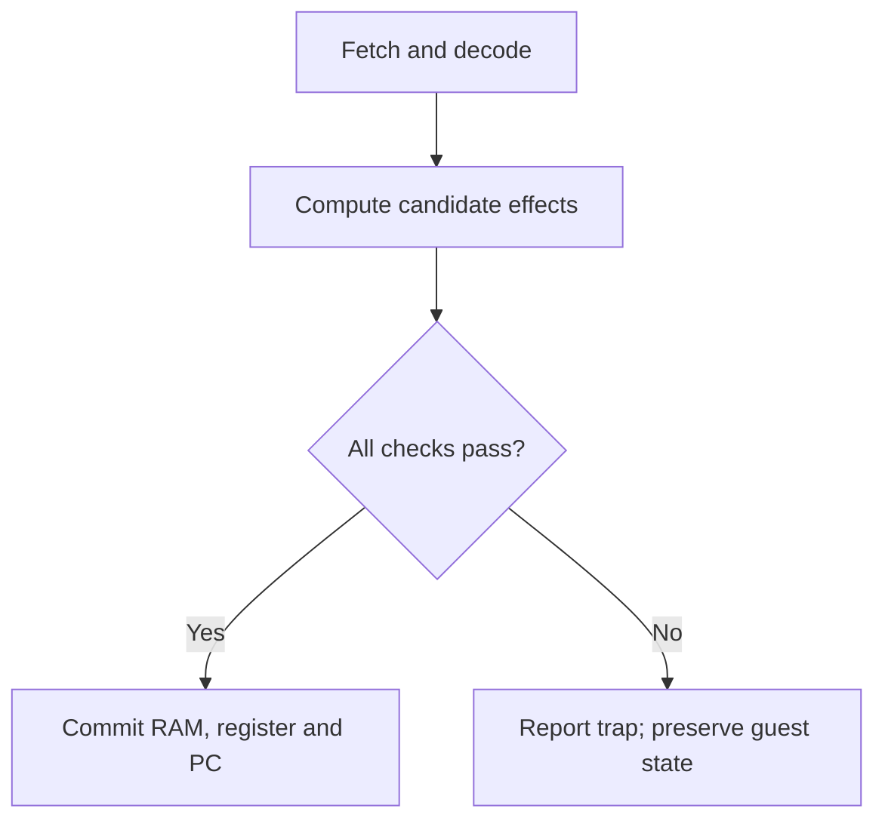

# Educational RV32 C model

A small, readable C11 model of a 32-bit RISC-V CPU, built one milestone
at a time as a step toward understanding how a processor runs Doom.
Each milestone is its own self-contained C file; earlier files are never
modified.

| File          | Milestone | Instructions        |
|---------------|-----------|---------------------|
| `cpu_step1.c` | 1         | `ADDI`              |
| `cpu_step2.c` | 2         | `ADDI`, `LBU`, `SB` |
| `cpu_step3.c` | 3         | `ADDI`, `LBU`, `SB`, `BNE` |

## Machine (same in every milestone)
- 32 registers (`uint32_t`), x0 always reads 0 and ignores writes
- 32-bit PC
- 256 bytes of little-endian RAM; guest addresses are indexes into that
  array, never native pointers
- Deterministic start: all zero, then the demo program is preloaded

## Build and run
    gcc -std=c11 -Wall -Wextra -Wpedantic -o cpu_step1 cpu_step1.c && ./cpu_step1
    gcc -std=c11 -Wall -Wextra -Wpedantic -o cpu_step2 cpu_step2.c && ./cpu_step2
    gcc -std=c11 -Wall -Wextra -Wpedantic -o cpu_step3 cpu_step3.c && ./cpu_step3

(`clang` works the same way.) Each program exits 0 if every check
passes and 1 otherwise.

---

## Milestone 1: `cpu_step1.c` (ADDI only)

Demo program:

| Addr | Word         | Instruction        |
|------|--------------|--------------------|
| 0    | `0x06400093` | `addi x1, x0, 100` |
| 4    | `0xFFC08113` | `addi x2, x1, -4`  |

RAM byte 100 is set to 5 and must stay unchanged. Final state:
x1=100, x2=96, x0=0, PC=8.

How one step works:
1. **Fetch**: four bytes at PC, little-endian, rebuilt into a word.
   PC must be 4-aligned and the whole word must fit inside RAM.
2. **Validate**: opcode `0x13`, funct3 `0`, otherwise rejected.
3. **Extract**: `rd = bits 11..7`, `rs1 = bits 19..15`,
   `imm = sign-extended bits 31..20`.
4. **Sign extension**: a 12-bit value of 2048..4095 becomes
   value − 4096. No signed right shifts are used.
5. **Compute**: `src + (uint32_t)imm` in unsigned arithmetic, which
   wraps modulo 2^32 and has no undefined behaviour.
6. **Writeback**: skipped when `rd` is x0.
7. **Advance**: PC += 4.

The demo stops after two instructions because `main()` counts to two.
That is a host-side test limit, not a guest HALT instruction.

---

## Milestone 2: `cpu_step2.c` (ADDI, LBU, SB)

Memory access arrives: the CPU can now read and write bytes of RAM.

| Instruction        | Opcode | funct3 | Format | Meaning                              |
|--------------------|--------|--------|--------|--------------------------------------|
| `ADDI rd,rs1,imm`  | `0x13` | 0      | I      | `rd = rs1 + imm`                     |
| `LBU rd,off(rs1)`  | `0x03` | 4      | I      | `rd = zero-extended RAM[rs1+off]`    |
| `SB rs2,off(rs1)`  | `0x23` | 0      | S      | `RAM[rs1+off] = low 8 bits of rs2`   |

Anything else is rejected.

Demo program:

| Addr | Word         | Instruction        |
|------|--------------|--------------------|
| 0    | `0x06400093` | `addi x1, x0, 100` |
| 4    | `0x0000C183` | `lbu x3, 0(x1)`    |
| 8    | `0x0C800113` | `addi x2, x0, 200` |
| 12   | `0x00310023` | `sb x3, 0(x2)`     |

Start data: `RAM[100]=5`, `RAM[200]=0`, `RAM[199]=RAM[201]=0xA5`
(neighbour sentinels that must not change). Final state: x1=100,
x2=200, x3=5, x0=0, PC=16, RAM[100]=5, RAM[200]=5, sentinels intact.

### What changed
- **Two immediate formats.** ADDI and LBU use the I immediate (bits
  31:20). SB uses the S immediate: bits 31:25 are `imm[11:5]` and bits
  11:7 are `imm[4:0]`. In SB, bits 11:7 are part of the offset and are
  **not** a destination register. SB changes no register.
- **Effective address** = `rs1 + (uint32_t)offset`, computed modulo 2^32.
  A negative offset becomes a large unsigned number that wraps back
  down, so -4 works naturally.
- **Safe memory access.** The address must be `< 256` before any RAM
  access. Byte accesses need no alignment (instruction fetches still do).
  Address 255 works; 256 and 0xFFFFFFFF are rejected.
- **LBU zero-extends**: byte 0xF0 becomes 240, never a negative value.
- **SB keeps only the low 8 bits**: storing 0x123456AB writes 0xAB.
- **Loads into x0** still validate and perform the read, then the
  register write is discarded. An invalid address still reports the error.
- **Validate before side effects.** `cpu_step()` first computes and
  checks everything, and only then commits (RAM write, register write,
  PC update). A rejected instruction or access leaves PC, all registers
  and all RAM unchanged.

The demo stops after four instructions via a host-side counter in
`main()`; it is not a guest HALT.

### Tests (all in `cpu_step2.c`)
- Retained from milestone 1: ADDI cannot change x0; rejected opcodes,
  funct3 values, misaligned PC, PC past RAM, PC=0xFFFFFFFC.
- New: LBU 0xF0 → 240; SB stores only 0xAB; offset -4 for LBU and SB;
  SB with nonzero bits 11:7 changes no register; byte 255 works while
  256 and 0xFFFFFFFF are rejected; a load to x0 (valid and invalid).
- Every rejection check also proves PC, registers and RAM are unchanged.

---

## Milestone 3: `cpu_step3.c` (ADDI, LBU, SB, BNE)

The PC can now jump, so the guest can run a loop. `cpu_step1.c` and
`cpu_step2.c` are unchanged; `cpu_step3.c` keeps all their tests.

| Instruction          | Opcode | funct3 | Format | Meaning                                  |
|----------------------|--------|--------|--------|------------------------------------------|
| `BNE rs1,rs2,offset` | `0x63` | 1      | B      | if `rs1 != rs2`: `PC = PC + offset`, else `PC + 4` |

Other branch types (BEQ, BLT, BGE, BLTU, BGEU) are rejected.

Guest program (preloaded as little-endian bytes, then really fetched
and decoded):

| Addr | Word         | Instruction                  |
|------|--------------|------------------------------|
| 0    | `0x06400093` | `addi x1, x0, 100`           |
| 4    | `0x0C800113` | `addi x2, x0, 200`           |
| 8    | `0x00300213` | `addi x4, x0, 3`             |
| 12   | `0x0000C183` | `loop: lbu x3, 0(x1)`        |
| 16   | `0x00310023` | `sb x3, 0(x2)`               |
| 20   | `0x00108093` | `addi x1, x1, 1`             |
| 24   | `0x00110113` | `addi x2, x2, 1`             |
| 28   | `0xFFF20213` | `addi x4, x4, -1`            |
| 32   | `0xFE0216E3` | `bne x4, x0, loop` (offset -20) |
| 36   | (nothing)    | host stops here              |

Start data: `RAM[100..102] = 5, 7, 9`, `RAM[200..202] = 0`,
`RAM[199] = RAM[203] = 0xA5` (sentinels).

Result after 21 completed instructions: x1=103, x2=203, x4=0, x3=9,
x0=0, PC=36; `RAM[200..202] = 5, 7, 9`; source bytes and sentinels
unchanged; exactly 3 stores; branch outcomes taken, taken, not taken.
(3 setup instructions + 3 loop passes of 6 instructions = 21.)

### How revisiting addresses makes the loop
The PC is just a number, and each step fetches the four bytes at that
address. Normally PC grows by 4, so execution walks forward through RAM
once. A *taken* BNE puts an earlier address (12) into the PC, so the CPU
fetches and decodes the bytes at 12, 16, 20, ... **again**. The code
exists only once in RAM; the PC simply returns to it. The loop does
different work each time because the registers changed: x1 and x2 each
moved on one byte and x4 counted down, so the same instruction words act
on different data. When x4 reaches 0, BNE is not taken, the PC falls
through to 36, and the loop ends.

### The B-type offset
The offset is a multiple of 2, so imm[0] is not stored. Its other bits
are scattered across the word and `imm_b()` reassembles them:

| Offset bit | Instruction bit(s) |
|------------|--------------------|
| imm[12]    | 31                 |
| imm[11]    | 7                  |
| imm[10:5]  | 30:25              |
| imm[4:1]   | 11:8               |
| imm[0]     | always 0           |

The 13-bit value is sign-extended without signed shifts (if bit 12 is
set the value is `field - 8192`). For `bne x4, x0, -20`: -20 is
`0x1FEC` in 13 bits, giving `0xFE0216E3`. The tests check this word
by hand-derived constants as well as by round trip.

### BNE rules
- Compares the full 32-bit values of rs1 and rs2.
- Writes no register and no data memory; it only chooses the next PC.
- Taken: `next PC = branch PC + offset` modulo 2^32.
  Not taken: `branch PC + 4`.
- A *taken* branch whose target is not 4-byte aligned is rejected with
  nothing changed. An *untaken* branch is accepted even if its unused
  target would be misaligned.
- The target is not range-checked by the branch itself. It is checked
  when the CPU fetches from it, which rejects a PC outside RAM.

### Host-side stop and budget (not HALT)
The demo stops when PC reaches 36, checked before each fetch, so the
instruction at 36 is never run. A maximum-step budget (100) catches
infinite loops. Running out of budget is reported as **failure**, never
as normal completion, and the program exits 1. Neither is a guest HALT
instruction.

### New tests (all in `cpu_step3.c`)
- B-immediate decoding, including hand-derived words for +2048, +4094
  and -4096, and a round trip across the offset range
- BNE taken and not taken (including a difference in only the top bit)
- Forward and backward targets
- A nonzero-numbered rs2 register (x6), and x0 as rs1
- No register or RAM change from BNE, taken or not
- Taken misaligned target rejected; untaken misaligned target accepted
- Out-of-RAM targets rejected at fetch time
- Unsupported branch types rejected
- Step budget: infinite loop reports failure; the demo needs exactly
  21 steps (budget 20 fails, budget 21 completes)
- Every rejection also proves PC, registers and RAM are unchanged

## Out of scope
Other branches, jumps, other loads/stores, caches, pipelines,
peripherals, QEMU, GUI, Doom.

---

## Milestones 4 and 5: current implementation

The sections above are preserved historical notes for steps 1–3. Their
instruction limits apply to those snapshots. The current core is `rv32i.c`:
it implements all 40 base RV32I instruction operations, with ECALL and EBREAK
reported as traps. This is an instruction-level C model with one hart, plain
RAM, and no privileged execution environment. It is not a cycle model or an
ISA certification result.

**Start here:** run `./test.sh`. Read `cpu_step4.c` to see the small nested-call
milestone, then `rv32i.h` and `rv32i.c` for the complete base integer model.
The instruction checklist is in [ISA_SUPPORT.md](ISA_SUPPORT.md), and actual
run results and remaining work are in [VERIFICATION.md](VERIFICATION.md).

### What was preserved

`cpu_step1.c`, `cpu_step2.c`, and `cpu_step3.c` are byte-for-byte copies of
the uploads. Their original tests still run, including their original
unsupported-instruction checks. `README.original.md` preserves the exact
uploaded README; this README keeps that text as its unchanged prefix.
`originals.sha256` and the test entry point verify these facts.

### Milestone 4: calls really return

This milestone was implemented and tested before the complete RV32I core.
It adds LW, SW, JAL and JALR to the step-3 instruction subset. The new full
core also reruns its nested-call program as a regression.

| Program location | What happens |
|---|---|
| main: 0, 4, 8 | Set sp=256, set a0=5, call A at 64; ra becomes 12 |
| A: 64, 68 | Reserve 16 bytes; save ra=12 at RAM[252..255] |
| A: 72 | Call B at 128; ra becomes 76 |
| B: 128, 132 | Add 1 to a0; return to 76 |
| A: 76, 80, 84 | Restore ra=12; release frame; return to main |
| main: 12 | Copy a0 to t0; host stops at PC=16 |

Observed: exactly 12 completed instructions; a0=6, t0=6, sp=256, ra=12,
PC=16, saved RAM word=12. The neighbour sentinel remains unchanged.
The stack starts one byte past RAM and grows down; no memory access occurs
at address 256. Calls do not automatically save a stack frame: the guest
instructions explicitly save and restore the return address.

### Milestone 5: complete RV32I execution

The execution flow remains small:



Register and address arithmetic uses 32-bit unsigned values and wraps modulo
2^32. Signed comparisons compare the two's-complement interpretation without
depending on host signed overflow or signed shifts. Arithmetic right shifts
fill the high bits explicitly. Immediates are reconstructed and sign-extended
in unsigned arithmetic. Loads into x0 still validate and read memory; only
the final register write is discarded. JALR reads its old source register
before writing its link, so rd=rs1 works.

### Alignment, traps and unsupported instructions

| Event | Defined behaviour |
|---|---|
| Instruction fetch | 4-byte alignment; all four bytes must fit in RAM |
| Byte / halfword / word data | Alignment of 1 / 2 / 4 bytes; complete access must fit |
| Misaligned taken branch or jump | Trap on the branch/jump; no link or PC update |
| Untaken branch | Its unused target cannot cause an alignment trap |
| Aligned target outside RAM | Jump/branch succeeds; following fetch reports access fault |
| Misaligned and out-of-range address | Alignment check takes priority |
| Invalid encoding or unsupported extension | `RV_ILLEGAL_INSTRUCTION`; no state change |
| ECALL / EBREAK | Separate `RV_ECALL` / `RV_EBREAK` statuses; PC stays at trapping instruction |
| FENCE | Complete in-order memory already satisfies the fence; advance PC by 4 |

All faulting/trapping instructions leave PC, all registers, and all RAM
unchanged. Earlier successful instructions remain committed. `RvTrap`
contains diagnostic status, instruction PC, word when fetched, and fault
address. It is host output, outside architectural state. There is no guest
trap-vector/CSR implementation, syscall ABI, or automatic resume.

Reserved/unsupported encodings are rejected rather than guessed. The explicit
exception required by RV32I is FENCE: ignore rd and rs1; conservatively handle
all fm/predecessor/successor configurations as a fence, including FENCE.TSO
and null-set hints. All RAM accesses complete before the next instruction;
there are no other harts, device operations or outstanding requests to wait
for. FENCE therefore needs no extra work here. FENCE.I is Zifencei and is
rejected; CSR instructions are Zicsr and are rejected. Other SYSTEM words,
including WFI and MRET, are also rejected. No blanket SYSTEM no-op exists.

### Configurable RAM and loading

`rv_init(&cpu, ram, size)` accepts a host-owned buffer from 4 bytes through
2^32 bytes, limited by host allocation and `size_t`. It zeros registers/PC,
and leaves RAM contents under host control. Tests exercise tiny 256-byte
machines and non-word-sized capacity. `rv_load_image()` validates the whole
copy before changing RAM. Guest addresses remain byte offsets into the
buffer. Guest code, data and stack share this RAM; no ROM or address
translation is needed for this milestone.

The sample runner loads a **flat little-endian binary at address 0**, starts
at PC=0, and observes a RAM completion signature. The ELF output is for
inspection and is not directly loaded. There is no ELF loader hidden here.

### Milestone 6: compiled C guest verified

A task-local Debian RISC-V GCC 14.2.0 toolchain was downloaded and unpacked
without a system installation. The guest is now cross-built and executed
through this interpreter: **596 image bytes, 565 retired instructions**,
checksum=90, count=6, initialized=7, BSS_before=0, nested_calls=6.
No QEMU or native execution of the guest was used. The previous ZIP remains
an unchanged snapshot of the earlier milestone.

On your Ubuntu laptop, if a RISC-V GNU cross compiler is available:

```bash
./test.sh
# Or select an installed compiler executable explicitly:
RISCV_CC=riscv64-unknown-elf-gcc ./test.sh
```

`build_guest.sh` also detects a Clang RISC-V backend with ld.lld. A missing
toolchain skips local rebuilding but executes the hash-checked, included
prebuilt C guest. A present compiler whose build fails makes the entry point
fail. The script installs no tools. Python 3 is needed for integration checks.
The GNU cross-build commands used by the script are equivalent to:

```bash
riscv64-unknown-elf-gcc -march=rv32i -mabi=ilp32 -mno-relax \
  -msmall-data-limit=0 -ffreestanding -fno-builtin -fno-pic -fno-pie \
  -fno-stack-protector -fno-omit-frame-pointer -O0 -g \
  -std=c11 -Wall -Wextra -Wpedantic -Werror -Wconversion -Wshadow \
  -c guest/guest.c -o build/guest.o
riscv64-unknown-elf-gcc -march=rv32i -mabi=ilp32 -mno-relax \
  -c guest/start.S -o build/start.o
riscv64-unknown-elf-gcc -march=rv32i -mabi=ilp32 -nostdlib -nostartfiles \
  -static -Wl,-T,guest/linker.ld -Wl,--no-relax -Wl,--build-id=none \
  build/start.o build/guest.o -o build/guest.elf
riscv64-unknown-elf-objcopy -O binary build/guest.elf build/guest.bin
./build/rv32-run build/guest.bin
```

The linked ELF declares `rv32i2p1`, ELF32 little endian, entry=0, and
16-byte stack alignment. Actual no-alias disassembly is included under
`guest/prebuilt/`. Calls use AUIPC/JALR; returns use JALR. The emitted
instruction set is ADD, ADDI, ANDI, AUIPC, BGEU, BNE, FENCE, JAL, JALR,
LUI, LW, OR, SLLI, SLTU and SW (see the saved disassembly). `-march=rv32i` excludes
M and compressed instructions; compiler and linker relaxation are disabled.
There is no libc, allocator or runtime library dependency in the guest.

### Reserved guest memory regions

| Inclusive byte range | Purpose |
|---|---|
| 0x0000–0xBFFF | Program text, read-only data, initialized .data, zeroed .bss |
| 0xC000–0xC03F | Reserved 64-byte signature block; first 24 bytes currently used |
| 0xC040–0xEFFF | Reserved gap, unused |
| 0xF000–0xFFFF | 4096-byte descending stack, initial sp=0x10000 |

The linker reserves these regions and rejects an oversized application.
The CPU has no memory protection; stack overflow is not automatically
detected. There is no heap. Initialized data has identical load/run addresses
and comes from the binary; no ROM-to-RAM copy is required. Startup sets sp
and gp, zeros every word of .bss, and calls `guest_main`. RAM begins poisoned
with 0xA5 except the cleared signature, so the host does not silently supply
zero-initialized globals for the guest.

The C guest checks BSS contents, fills an array in a loop via
`guest_main -> outer -> inner`, and accumulates a checksum. `noinline` and
`-O0` preserve the nested calls. The initialized global supplies 7. Expected
array values, derived from the source, are 10,12,14,16,18,20, with sum 90.
The observed checksum is 90. Integration checks also patch the input global
from 7 to 9: execution computes 102 and the host correctly rejects the changed
signature. Removing the startup BSS store produces guest FAIL from poisoned
RAM. Budget 565 succeeds; budget 564 fails. These checks exercise the actual
compiled image, separate from the small hand-encoded runner fixture.

| Signature byte offset | Contents |
|---|---|
| +0 | 0 while running; DONE=0x444F4E45 or FAIL=0x4641494C written last |
| +4 | Array checksum |
| +8 | Array length, 6 |
| +12 | Initialized global, 7 |
| +16 | OR of BSS values before use; must be 0 |
| +20 | Number of calls to inner, 6 |

Assembly publishes status after a FENCE. `rv_run_signature()` checks status
before the budget, so finishing on the final allowed instruction succeeds.
An unchanged status followed by budget exhaustion fails. ECALL/EBREAK are
traps, not completion. The default budget is 1,000,000 successful steps.
Host verification reads guest RAM and computes a reference checksum; it
never supplies guest results or a completion store. A tiny hand-encoded
runner fixture tests this protocol separately; it is not the C guest.

Runner arguments: `./build/rv32-run IMAGE.bin [RAM_BYTES [BUDGET [SIGNATURE_ADDRESS]]]`.
Defaults match the memory map above. A custom smaller image can use a
different signature address and buffer size; it needs a matching linker
map/startup. The runner's payload checks are for this example's five fields.

### Files to read in order

1. `cpu_step4.c`: save a return address, make a nested call, restore it.
2. `rv32i.h` and `rv32i.c`: state, decode, operation, validation, commit.
3. `test_rv32i.c`: worked inputs and self-checking edge cases.
4. `rv_run.h`, `rv_run.c`, `test_run.c`: completion versus budget versus trap.
5. `guest/start.S`, `guest/linker.ld`, `guest/guest.c`: how C would reach the CPU.

Specification reference: [official RV32I v2.1, ISA manual release v20260120](https://docs.riscv.org/reference/isa/v20260120/unpriv/rv32.html),
particularly integer operations, control transfer, loads/stores, FENCE,
and environment traps. Checked 21 November 2026.

Current boundary: base instruction execution and host-side verification.
M, privileged state, devices, graphics, Doom, caches and pipelines remain
outside this milestone. Next is studying real Doom code and selecting small
workloads to port before adding I/O. No Doom or FPS claim is made here.

### Try the verified image without a cross compiler

Run `./test.sh` after extracting this folder. GCC and Python 3 suffice to
rebuild the host interpreter and execute the included RV32I guest binary.
The source/image hash manifest prevents silently using stale prebuilt files.
With a cross compiler on PATH the same command rebuilds the guest instead.

GNU RISC-V ld rejected the earlier `--oformat=binary` command; conversion
now uses target objcopy after ELF linking. Explicit ELF program headers
separate RX text and RW data and eliminate the RWX-segment linker warning.
This describes ELF metadata; our simple RAM model has no memory protection.


## Milestone 7: keyboard-controlled square

See START_HERE.md and platform/README.md. Run ./run_square.sh for the
window or ./run_square.sh --headless for deterministic tests. This optional
ECALL execution environment adds display, input and time around the unchanged
RV32I core. Earlier sections describe the previous milestones. ./test.sh now
includes the square guest tests as well as every earlier regression.


## Milestone 8: runtime foundation

Start with START_HERE.md, runtime/README.md and runtime/DOOM_AUDIT.md.
The unchanged RV32I interpreter now also executes an independently compiled
runtime test guest covering memory functions, allocation, WAD reads and
software arithmetic. ./test.sh retains earlier tests and adds this guest.


## Milestone 9: Doom engine integration

See START_HERE.md and doom/README.md. ./run_doom.sh boots the engine with
bundled Freedoom Phase 1 data. The RV32I core is unchanged; the guest uses
Picolibc plus an explicit host ECALL environment. Earlier sections remain
historical records. DOOM_GAME_TEST=1 ./test.sh enables the long engine test.


## Controls correction — 22 November 2026

See CONTROLS_FIX.md. The native adapter now sends engine KEY_FIRE and KEY_USE.
Ctrl/F fires; Space/E uses. All 21 key press/release IDs have focused coverage.
Run ./run_controls_fixed.sh for the fast prebuilt-guest launcher.
No long tests or GUI smoke tests were run for this correction.
