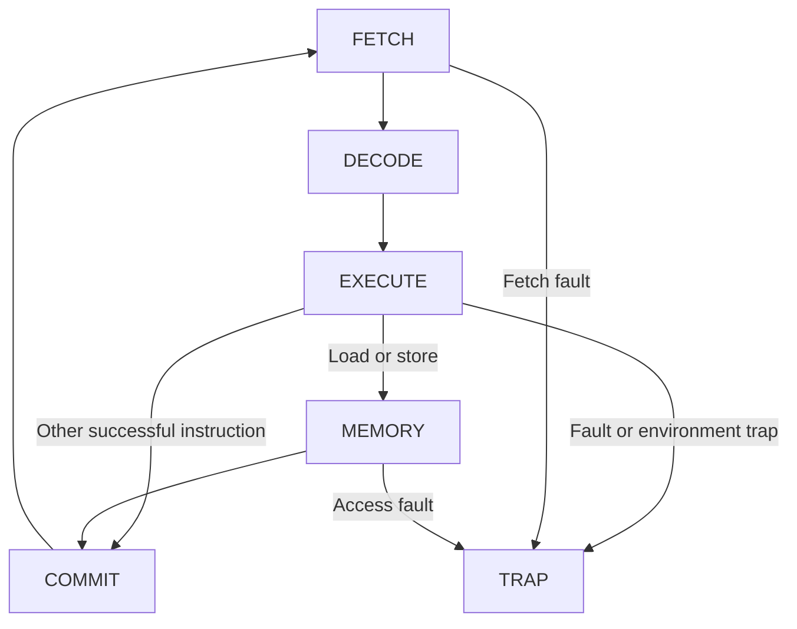

# Step 3 — our RTL fetches and runs a program

**Before:** the testbench handed each instruction to the decoder.
**Now:** the core stores PC, fetches an instruction from RAM, decodes it,
executes it, and chooses the next PC itself.

This complete project preserves the earlier blocks/tests. Extract it to a
new `rv32i_rtl_step3` folder; keep your earlier projects.

## Try this first in Vivado

1. Add all **six `rtl/*.sv`** files as Design Sources.
2. Add **`tb/tb_core_demo.sv`** as a Simulation Source. Set simulation top
   to **`tb_core_demo`** (change it from `tb_decode_demo`).
3. Run Behavioral Simulation, then **Run All**. No external data file needed.

Expected console ending:

```text
PASS RTL_CORE_DEMO: fetched 4 instructions; x6=39 RAM[512]=39; explicit EBREAK trap
```

Watch `pc_o`, `instruction_o`, `state_o`, `retire_valid_o`, `x6_value`,
`ram_value`, `mem_valid_o` and `trap_valid_o`.

## Understand the tiny program

| PC (bytes) | Instruction | What it does |
|---:|---|---|
| 0 | `addi x5,x0,512` | Remember the data's address in x5 |
| 4 | `lw x6,0(x5)` | Read RAM word at byte address 512: x6 becomes 40 |
| 8 | `addi x6,x6,-1` | x6 becomes 39; RAM is still 40 |
| 12 | `sw x6,0(x5)` | Write 39 back to RAM |
| 16 | `ebreak` | Report an explicit trap; stop this teaching core |

PC is a **byte address**, so four-byte instructions normally move it by four.
The RAM value is data; the words at PCs 0–16 are instructions. Both live
in one simulated RAM. The decoder sees the instruction stored in IR.

## One instruction, several clocks



| `state_o` | State | Simple job |
|---:|---|---|
| 0 | FETCH | Ask RAM for instruction at PC; wait for completion |
| 1 | DECODE | Read registers; retain operands and branch decision |
| 2 | EXECUTE | Calculate value/address/target; check instruction/alignment |
| 3 | MEMORY | Loads/stores only: complete one data access |
| 4 | COMMIT | Write destination if needed; update PC; pulse retirement |
| 5 | TRAP | Report error/ECALL/EBREAK; remain stopped until reset |

`LW` needs MEMORY; `ADDI` skips it. The ALU is reused across clocks.
PC stays at the current instruction until commit. A store changes RAM on
its successful memory-completion edge, then commits without a second write.

Recorded waveform: [core-demo.png](verification/step3/core-demo.png).

## What is implemented and checked

Functional, unprivileged **RV32I execution**: arithmetic, shifts, comparisons,
upper immediates, six branches, calls/returns, all base load/store widths,
FENCE and explicit ECALL/EBREAK traps. The detailed checklist is in SPEC.md.
No M extension, pipeline, cache, interrupt/CSR system or Doom runtime bridge.

Headless checks here: **72 differential runs, 201,438 core checks**, all 40
base instruction names exercised (ECALL/EBREAK as traps), plus preserved
block tests and reset cancellation. This is testing, not ISA certification.

```bash
./test.sh vivado       # Vivado environment loaded; GCC + Python 3 required
# or
./test.sh iverilog     # Icarus installed; GCC + Python 3 required
```

See VIVADO.md for setup and VERIFICATION.md for actual results/limits.
No GUI is launched by test.sh. Vivado was unavailable in the build
environment: its route is supplied, not reported as locally tested.

**Recall:** PC chooses the instruction; IR remembers it; the decoder chooses
actions; the controller decides *when* those actions happen.

Next: run this small demo in Vivado, inspect one load across the states,
then use the full differential suite before larger compiled guests.
Synthesis/timing review comes after this baseline; GDSII needs a separate
technology-specific physical-design flow.
