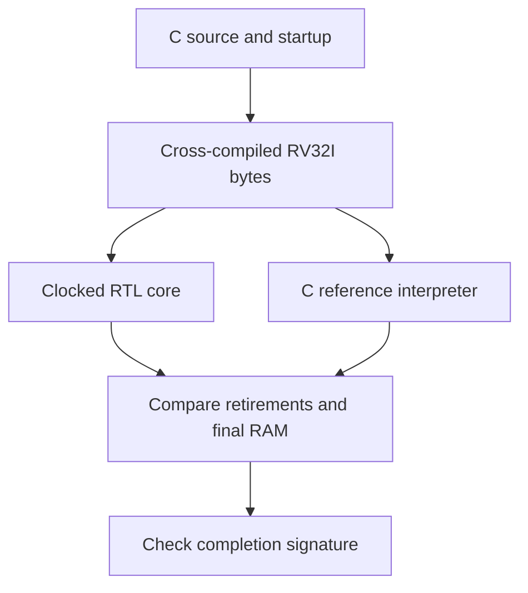

# Step 4 — compiled C runs on our RTL processor

**The processor executes compiler-generated instructions now.** Its RTL is
unchanged from the port-fixed Step3 core you verified in Vivado.

The program fills a six-element array through nested function calls, adds
the results, and checks initialized/zero-initialized globals. It runs once
without compiler optimization and once with -O2, using zero-wait and delayed
memory. Negative tests check changed input data, broken startup and budgets.

## Run this new milestone first

Extract to **~/Documents/DOOMed/rv32i_rtl_step4**. In Ubuntu:

```bash
source /home/perlin/Documents/projects/2025.2/Vivado/settings64.sh
cd ~/Documents/DOOMed/rv32i_rtl_step4
./run_guest.sh vivado
```

Requires native GCC, Python3 and an installed riscv64-unknown-elf-gcc or
riscv32-unknown-elf-gcc with matching binutils. Your earlier project used the
former. The runner prints RUN before each simulation so progress is visible.

Expected final marker:

```text
PASS RTL_COMPILED_C: O0/O2 arrays, nested calls, initialized globals, BSS; changed data/BSS/budget negatives
```

The normal program's signature is checksum90, count6, initialized7,
BSS_before0, nested_calls6. Deliberately bad cases print **expected protocol
rejection**; those are successful negative tests, not a normal guest pass.

This focused command runs only nine new simulations. `./test.sh vivado`
also repeats the preserved Step3 suites. Neither command opens GUI windows.
An Icarus installation can use `./run_guest.sh iverilog`.

## What you should study

1. **guest/guest.c** — what we ask the computer to do.
2. **guest/start.S** — setup before the C function can run.
3. **guest/linker.ld** — where code, globals, signature and stack live.
4. **LESSON.md** — actual assembly explained in simple words.
5. **guest/prebuilt/O0/guest.dis** — the recorded compiler output to explore.



Native GCC builds the host checker. The RISC-V compiler builds the guest.
**guest.c is never run natively on the laptop as the test result.** Its bytes
are fetched/decoded/executed by rv32_core.sv during simulation.

## Actual verification status

The nine new runs passed under Icarus here, together with the preserved
regression. Your supplied output establishes that Step3's72 runs and201,438
checks passed in Vivado. Step4's new bench/runner still needs your Vivado run;
Vivado is unavailable in this environment. See VERIFICATION.md for evidence.

The normal -O0 program retired566 instructions; -O2 retired371 for the same
answer. These are observations for this tiny guest, not Doom FPS or hardware
clock-frequency results. No multiplier, cache, pipeline or new peripherals.

Next comes a small runtime/host-service connection and larger workloads.
Doom on RTL and synthesis/GDSII remain later milestones.

**Recall:** C expresses the task; assembly lists the steps; the RTL performs
each step through FETCH, DECODE, EXECUTE, MEMORY when needed, and COMMIT.
