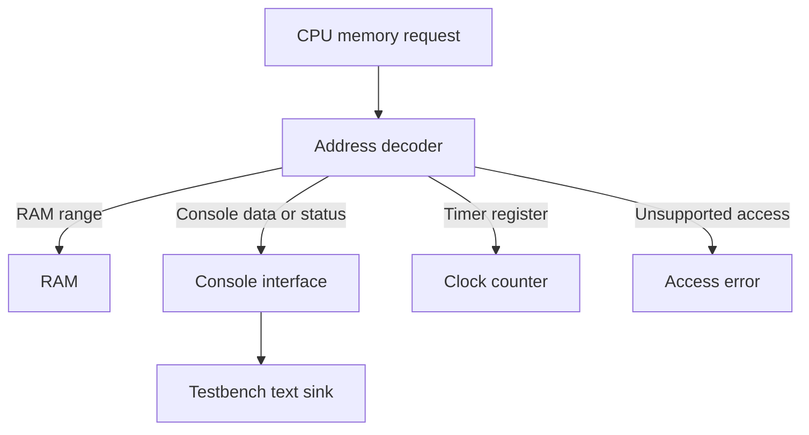

# From storing a number to printing a character

## 1. Does the CPU need a PRINT instruction?

No new instruction was added. The guest uses an ordinary byte store:

```c
*(volatile uint8_t *)(uintptr_t)0x10000000 = 'H';
```

The selected RISC-V platform/compiler lets this pointer name a device address.
The instruction stream contains SB. Our address decoder sees10000000 and
routes the request to console logic rather than indexing the RAM array.

**A high device address does not require a huge RAM allocation.** The address
is a number tested by hardware comparators. Only00000000–00003fff names our
16KiB RAM;10000000 names a different destination.



## 2. Follow the actual output instructions

These rows come from the recorded -O2 io_guest disassembly. Addresses may
change with a different compiler; fresh mixed disassembly is in build/io/O2.

| C or actual assembly | What happens in the computer |
|---|---|
| `lui a3,0x10000` at 0x80 | Put device address10000000 into x13 |
| `lw a5,0(a4)` at 0x84, a4=10000004 | Read console readiness into x15 |
| `andi a5,a5,1` | ALU keeps status bit0 |
| `beq a5,zero,0x84` | If not ready, PC returns to the status read |
| `sb a0,0(a3)` at 0x94 | Send low8 bits of a0=x10 to the console data address |

For the first character, a0 holds48 hexadecimal, which is the byte for H.
SB computes the effective address and enters MEMORY. The core drives:

| Bus item | First console character |
|---|---|
| Address | 10000000 |
| Write mask | 0001, selecting byte lane0 |
| Write data | 00000048 |
| Read mask | 0000 |

rv32_mmio asserts tx_valid with byte48. When the sink also asserts tx_ready
at a rising edge, it accepts H and the store completes. The CPU then commits
without writing a destination register. The testbench writes that byte to
the console file; the Python runner verifies/displays the text.

The actual output stream is 26 bytes, including newline; their byte sum is2023.
All four normal compiled runs produced exactly that stream.

## 3. Why do we need readiness and waiting?

The receiver may be busy. If ready=0, the store remains outstanding: address,
data and masks stay stable, and no character has been accepted. When ready=1,
one valid/ready handshake accepts one character. Keeping the request active
during earlier waiting clocks must not print extra copies.

Reading status is only a snapshot. Readiness can change before the later
SB reaches the device, so the actual store also waits for ready. This handles
that race correctly. A receiver that never becomes ready can stall the CPU;
the verification budget/watchdog bounds the test, not a hardware bus timeout.

## 4. Reading time uses another ordinary load

```c
uint32_t now = *(volatile uint32_t *)(uintptr_t)0x10000010;
```

The decoder selects LW. Address routing selects a 32-bit hardware counter.
The value sampled on successful completion enters the destination register.
The counter increments once per active clock, including memory waiting clocks.
It wraps fromFFFFFFFF to00000000 and resets to its configured reset value.

The guest waits using unsigned subtraction:

```c
do { after = timer_read(); } while ((uint32_t)(after - before) < 64u);
```

Example across wrap: before=FFFFFFF0, after=00000030. The32-bit unsigned
difference is40 hexadecimal=64 ticks. This method handles one modular wrap
for intervals that stay within the intended32-bit range; it cannot tell how
many whole counter periods passed.

Ticks are **not automatically milliseconds**. Conversion would require a
defined hardware clock frequency. Our10ns stimulus clock is not evidence
that the future chip meets100MHz.

## 5. What does volatile do here?

The compiler must retain the relevant volatile device accesses according to
its target rules; this prevents a polling read from being replaced by one
ordinary cached C value. It does not add a cache, make an operation atomic,
or provide a general memory-ordering barrier. The guest also uses an explicit
FENCE with a compiler memory clobber. Our current single outstanding access
already completes in order, so the existing core's FENCE needs no extra wait.
Revisit that policy when adding buffering, multiple harts or other devices.

## 6. How can C and RTL agree if their clocks differ?

A functional interpreter does not have the RTL's clock-by-clock timing.
Pretending its next timer value is a fixed constant would test the wrong thing.

We therefore run RTL first and record external timer/status responses at
completed bus transactions. The C reference then replays those same inputs,
executes the guest instructions independently and checks every request's
address/order/data/error policy. Python compares the full retirement states
and final RAM against RTL. Console output is checked independently too.

**Replay alone cannot prove a timer was correct.** The benches separately
check its value against an independent counter on every clock, including
read-completion sampling, wraparound and reset. This separates CPU instruction
verification from device timing verification.

## 7. What is the new hardware?

rtl/rv32_mmio.sv adds address comparisons, response selection, an optional
wait counter, a 32-bit timer and console handshake signals. The previous CPU,
ALU, register file and decoder were not edited. External RAM/file I/O are
simulation infrastructure; console wiring is not a physical UART yet.

Recall: explain why SB to RAM changes memory while SB to10000000 prints a
character, and why a waiting store must not print on every clock.
